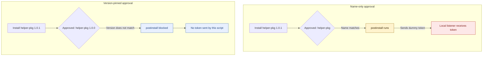
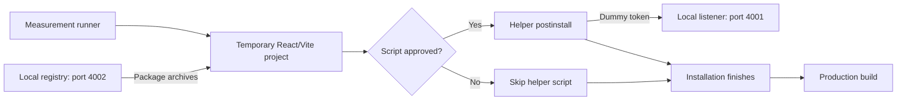
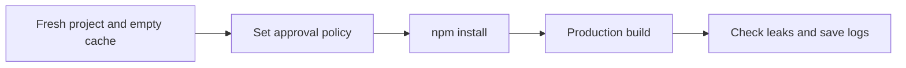

# Defeating npm Supply-Chain Attacks: Version-Pinned allowScripts in Web Builds

<!--
Content for an approximately 8-minute talk. Each horizontal rule starts a slide.
HTML comments contain speaker notes. Render Mermaid blocks as diagrams.
Suggested speaking split: slides 1-5, 6-10, and 11-16.
Order: rationale, selected topic, implementation and results, conclusion.
Web sources checked on 2026-11-23. Keep source numbers, titles and visible URLs
on the slides so citations also work in a recording or printout.
Internal evidence: README.md, REPORT.md and the summaries in
results/measurement-Z1UmGj, results/measurement-oJk235 and results/measurement-AgO6hZ.
Internal paths in notes are for authors, not slide footers.
-->

## Slide 1: Rationale: The 2026 TanStack supply-chain attack

**Can version-pinned approvals stop a changed dependency from leaking a dummy token, and what does it cost?**

| TanStack incident | Confirmed detail [1] |
| --- | --- |
| Date | May 11, 2026 |
| Scope | 84 malicious versions across 42 `@tanstack/*` npm packages |
| Execution | A malicious dependency ran a `prepare` lifecycle script during installation |
| Payload | Harvested and sent out credentials from developer or CI environments |

**Why this topic:** installing a trusted package's new version can run attacker code.

**CSC13114: Advanced Web Development Seminar**  
**Team:** 23120131, 23120135, 23120143

**[1] TanStack, Postmortem: TanStack npm supply-chain compromise**, published May 11, 2026, updated May 15, 2026.  
https://tanstack.com/blog/npm-supply-chain-compromise-postmortem  
Accessed November 23, 2026.

<!-- Speaker notes (~30 seconds): Open with the question and the May 2026 incident. TanStack's postmortem describes an install-time prepare script, not a postinstall hook. Our experiment uses a simpler postinstall dummy leak to test script approval. It does not reproduce the full incident or prove that npm 12 would stop the entire attack chain. -->

---

## Slide 2: Rationale: More attacks used install scripts

| Date in 2026 | Attack | Lifecycle script | What it did |
| --- | --- | --- | --- |
| March 31 | Axios [4] | `postinstall` | Added `plain-crypto-js@4.2.1`, which downloaded a remote access trojan |
| May 11 | TanStack [1] | `prepare` | Ran a malicious dependency during installation and harvested credentials |
| June 1 | Red Hat Cloud Services / Miasma [5] | `preinstall` | Ran malicious `index.js` code targeting developer and cloud credentials |
| August 4 | Keyv and Cacheable / ChainDrop [6] | `preinstall` | Launched a credential stealer and spread through other packages |

**Shared pattern:** dependency installation runs attacker code through a lifecycle script.

**[4] JFrog: Cross-Platform Threat - Axios Package Compromise**  
https://research.jfrog.com/post/axios-compromise/  
**[5] Wiz: Miasma: Supply Chain Compromise in RedHat npm Packages**  
https://threats.wiz.io/all-incidents/miasma-supply-chain-compromise-in-redhat-npm-packages  
**[6] Socket: Keyv and Cacheable supply-chain attack**  
https://socket.dev/blog/popular-npm-packages-in-the-keyv-and-cacheable-namespaces-compromised-in-active-supply-chain  
Accessed November 23, 2026. TanStack source [1] is on the previous slide.

<!-- Speaker notes (~30 seconds): Show the timeline from March to August 2026. The initial compromises differ, including stolen accounts and CI workflow abuse. The shared attack pattern is install-time execution through dependency lifecycle scripts. These incidents motivate the experiment. Our one synthetic test does not establish that npm 12 blocks each full attack chain. ChainDrop occurred after npm 12.0.0 was released, so do not imply it caused that release or proves a bypass of its default policy. -->

---

## Slide 3: Rationale: What changed in npm 12?

**npm 12.0.0 was released on July 8, 2026.** [2]

| Control | What it does |
| --- | --- |
| Default policy | Blocks dependency lifecycle scripts unless approved |
| `allowScripts` | Stores script approvals in the root `package.json` |
| Version-pinned approval | Allows scripts for a specific package version |
| Name-only approval | Allows scripts for any version of that package |

Approvals are version-pinned by default. [3]

**[2] npm CLI, v12.0.0 release notes**  
https://github.com/npm/cli/releases/tag/v12.0.0  
**[3] npm Docs, npm-install-scripts, Description and allow-scripts-pin**  
https://docs.npmjs.com/cli/v12/commands/npm-install-scripts/  
Both accessed November 23, 2026.

<!-- Speaker notes (~35 seconds): The release notes support the date and blocking default. The command docs explain pinning. This policy covers dependency install scripts. A lockfile pins installed dependencies, while allowScripts controls permission to run their install scripts. -->

---

## Slide 4: Selected topic: Our research question

> In a React build, how many simulated `postinstall` leaks does version-pinned `allowScripts` block compared with name-only approval, and what is the cost?

| Measure | Unit |
| --- | --- |
| Runs with a dummy-token leak | Count and percentage |
| Install plus production-build time | Milliseconds, median and range |
| Extra approval commands | Count |

The original registration proposed **25 packages and several attack types**. The final study tests a smaller scope.

<!-- Speaker notes (~25 seconds): This is a simpler wording of the registered question. Keep the distinction between the proposal and the completed experiment. The exact 25-package count was not established. -->

---

## Slide 5: Selected topic: What we tested

| Item | Completed experiment |
| --- | --- |
| App | React/Vite with esbuild, sharp, husky and their dependencies |
| Attack | One helper package with a simulated `postinstall` leak |
| Comparison | Name-only approval versus approval pinned to an older version |
| Repetitions | Five runs per policy |
| Upgrade | Prior approval written into each fresh project's manifest |
| Workflow check | One esbuild re-approval check per policy |

**Five repeated runs test one attack scenario. Actual upgrades were not tested.**

<!-- Speaker notes (~25 seconds): The experiment models the approval state after a version change. It does not install the old helper and then upgrade it. Explain this before showing results. -->

---

## Slide 6: Selected topic: One policy change

Both policies install **`helper-pkg@1.0.1`**. Only the helper approval changes.

**Name-only approval, minimal `package.json` example:**

```json
{ "allowScripts": { "helper-pkg": true } }
```

**Version-pinned approval, minimal `package.json` example:**

```json
{ "allowScripts": { "helper-pkg@1.0.0": true } }
```

| Installed version | Name-only approval | Old-version pin |
| --- | --- | --- |
| `helper-pkg@1.0.1` | Script allowed | Script blocked |

**[3] npm Docs, npm-install-scripts, Description**  
https://docs.npmjs.com/cli/v12/commands/npm-install-scripts/  
Accessed November 23, 2026.

<!-- Speaker notes (~30 seconds): These examples show only the helper policy. The runner also holds the esbuild approval fixed. Permission for helper-pkg covers the tested version. Permission for helper-pkg@1.0.0 does not cover 1.0.1. -->

---

## Slide 7: Illustration: Stop the script before it sends the token

Both sides install **`helper-pkg@1.0.1`** with the same dummy token available.



**npm blocks the script from starting. It does not filter the token or block the network request.**

**[3] npm Docs, npm-install-scripts, Description**  
https://docs.npmjs.com/cli/v12/commands/npm-install-scripts/  
Accessed November 23, 2026.

<!-- Speaker notes (~35 seconds): Trace the top row: the package name matches, the script runs, and the local listener receives the dummy token. Trace the bottom row: the installed version does not match the approved version, so the script never starts. The token stays out of the listener because this script did not run. This is our synthetic scenario, not proof that every other path to a leak is blocked. -->

<!-- Animation instructions for the slide author, not visible slide text:
Use four click-triggered reveals. Keep both rows in place so the audience can compare.
1. Show the two install boxes. Say: "Both sides install the same new version."
2. Reveal both approval checks and their incoming arrows. Highlight the matching
   package name on top and the different version numbers below.
   Say: "The name matches on both sides, but only version 1.0.0 was approved below."
3. Reveal the two decisions: "postinstall runs" on top and "postinstall blocked"
   below. Show a stop symbol at the blocked script. Say: "npm stops this script
   before it starts." Do not animate a token reaching the approval check.
4. Move a small "DUMMY TOKEN" label along the top outgoing arrow into the listener.
   Reveal the bottom outcome with no token movement. Show the takeaway sentence.
Use labels and a stop symbol as well as color. Keep unrelated nodes still.
For a PDF or a tool without animation, use four copies of this slide. Each copy
shows one more stage, with the same layout. These are reveal frames, not new topics.
Mermaid supplies the static diagram. The presenter adds these reveals in the slide tool.
-->

---

## Slide 8: Implementation: Local test setup



- The helper waits **two seconds**, then sends a dummy token.
- It does not scan the machine or collect real secrets.
- The runner records the listener count and install-and-build time.

**Recorded environment:** Windows x64, Node v26.12.1, npm 12.2.2.

<!-- Speaker notes (~35 seconds): The approval decision applies during installation. The runner performs the production build after installation finishes. Both services run on localhost. Initial package preparation needs internet access. Outbound-network isolation was not independently verified. -->

---

## Slide 9: Implementation: How each run works



**Five runs per policy, alternating name-only and pinned runs.**

| Held fixed | Checked for each run |
| --- | --- |
| Machine, app and local services | Install and build succeed |
| Helper version and esbuild approval | Correct helper version installed |
| Dependency identities | Lockfile package URLs point to the local registry |

**Timing:** `npm install` plus production build, measured in milliseconds.

<!-- Speaker notes (~30 seconds): Every run starts with a new project and cache. The summary checks matching dependency identities across runs. Local registry URLs do not prove that all outbound network traffic was blocked. -->

---

## Slide 10: Implementation: Run the measurement

After cloning and checking the tools:

```sh
npm install
node mock-registry/setup-fixtures.js
node mock-registry/download-packages.js
npm run measure
```

- Use npm **12.2.2**, compatible Node.js and `tar`.
- Internet is needed for initial setup.
- Use a clone path without dot-prefixed folders.
- The command starts the local services and saves raw results.

**Demo:** show the measurement running or open its saved summary.

<!-- Speaker notes (~35 seconds): Show actual output with leak counts, median and range. Use npm.cmd if PowerShell blocks npm.ps1. Do not describe saved output as a live rerun. -->

---

## Slide 11: Result: The old pin stopped the dummy leak

| Primary measurement | Name-only | Version-pinned |
| --- | ---: | ---: |
| Valid runs | 5/5 | 5/5 |
| Runs with a dummy-token leak | 5/5 | 0/5 |
| Runs without a dummy-token leak | 0/5 (0%) | 5/5 (100%) |

**The pinned policy blocked the helper script in all five runs.**

This is one simulated attack repeated five times per policy.

<!-- Speaker notes (~30 seconds): The headline is zero leaking runs out of five under the pinned policy. The 100% figure only describes the tested runs. It does not measure protection against all supply-chain attacks. Evidence: measurement-Z1UmGj/summary.json. -->

---

## Slide 12: Result: Build time needs context

| Install plus production build | Name-only | Version-pinned |
| --- | ---: | ---: |
| Median | 8,312.48 ms | 5,295.59 ms |
| Minimum | 7,493.17 ms | 5,157.32 ms |
| Maximum | 13,168.78 ms | 5,946.79 ms |

- Five runs per policy.
- Name-only runs include the helper's **two-second delay** and dummy submission.
- Pinned runs skip that script.

**We measured the full scenario. We did not isolate the time cost of the approval policy.**

<!-- Speaker notes (~35 seconds): Pinning was faster in this fixture because the blocked script did no simulated work. This does not show that pinning normally speeds up builds. Other execution conditions can also affect time. Evidence: measurement-Z1UmGj/summary.json. -->

---

## Slide 13: Result: Reruns gave the same leak counts

| Measurement set | Name-only median | Pinned median |
| --- | ---: | ---: |
| Primary run | 8,312.48 ms | 5,295.59 ms |
| Same-workspace rerun | 9,951.40 ms | 6,976.20 ms |
| Fresh public clone | 7,753.24 ms | 5,396.30 ms |

**Each set had 5/5 leaking name-only runs and 0/5 leaking pinned runs.**

- The fresh clone also repeated the **0 versus 1** approval-command result.
- Timing ranges changed across runs.
- All tests used the same Windows machine.

<!-- Speaker notes (~30 seconds): Rerun ranges extended beyond the first ranges. Full ranges are in the saved summaries. A fresh clone checks setup on the same machine. It is not an independent-machine test. Evidence: summaries in measurement-Z1UmGj, measurement-oJk235 and measurement-AgO6hZ. -->

---

## Slide 14: Limits: What we still need to test

| Limit | Next test |
| --- | --- |
| Only one fake attack was tested | Test other lifecycle scripts and attacks in transitive dependencies |
| We set the old approval directly, without upgrading the package | Install the old version first, then upgrade to the new version |
| The fake attack adds a two-second wait, which affects build time | Use a harmless script with no added wait to measure the policy's time cost |
| One esbuild workflow check | Measure review time across more updates |
| One Windows machine | Repeat on other machines and operating systems |
| Local URL checks only | Independently check outbound network isolation |

**An approved script can still be unsafe. Approval requires review.**

<!-- Speaker notes (~25 seconds): These are future tests, not completed work. Exact-version approval limits automatic trust at a version change. It does not decide whether the new code is safe. -->

---

## Slide 15: References: TanStack and npm sources

**[1] TanStack: Postmortem: TanStack npm supply-chain compromise**  
Published May 11, 2026. Updated May 15, 2026.  
See TL;DR and What the malware does for the affected packages and install-time payload.  
https://tanstack.com/blog/npm-supply-chain-compromise-postmortem

**[2] npm CLI: v12.0.0 release notes**  
Released July 8, 2026. See Breaking Changes for dependency lifecycle script blocking.  
https://github.com/npm/cli/releases/tag/v12.0.0

**[3] npm Docs: npm-install-scripts**  
See Description and `allow-scripts-pin` for pinned approvals and name-only entries.  
https://docs.npmjs.com/cli/v12/commands/npm-install-scripts/

**All sources accessed November 23, 2026.**

<!-- Speaker notes (~15 seconds): These sources support the rationale and npm behavior. Result tables come from our saved logs. The npm v12 documentation URL tracks the v12 series. The experiment used npm 12.2.2. -->

---

## Slide 16: Conclusion: Use pins with a review process

| Finding | Result |
| --- | --- |
| Dummy-token leaks | Zero in five pinned runs, versus five in five name-only runs |
| Extra approval work | One esbuild approval command. Human review time was not measured. |
| Build outcome | The esbuild build passed before and after approval. |
| Test scope | One fake attack scenario |

**Recommendation:** use version-pinned approvals when the team can review changed scripts and handle pending approvals.

Before adoption, teams with frequent updates and little review capacity should plan who will handle that work.

**A version change creates a review point. The review still matters.**

<!-- Speaker notes (~30 seconds): End with the recommendation and its condition. Pinning stopped the changed helper from running automatically in this test. The next approval still needs a careful review. -->


